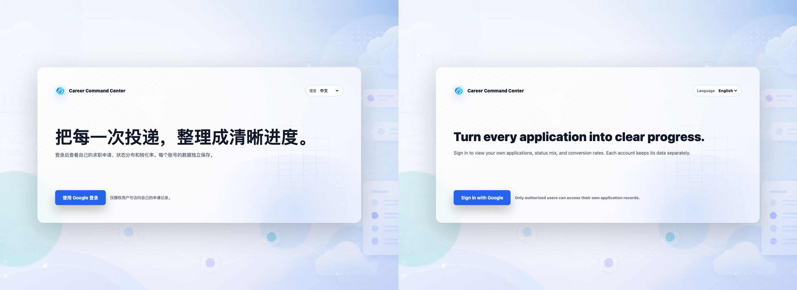
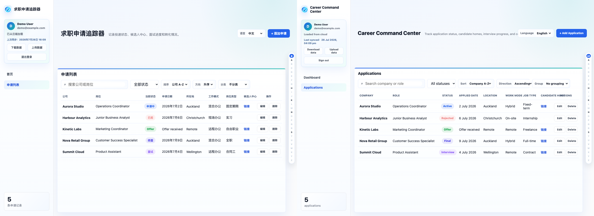
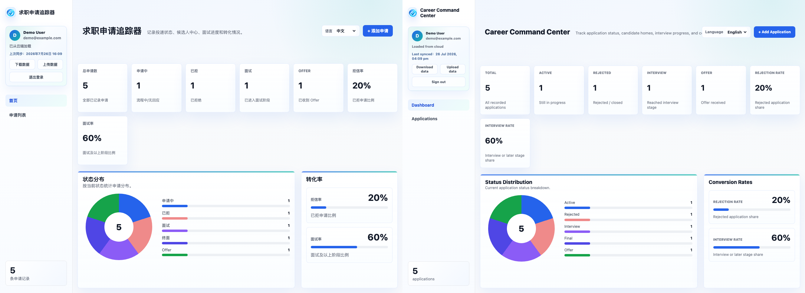

# Career Command Center

A bilingual job application tracker project covering application workflows, candidate-portal organization, status tracking, search, filtering and dashboard summaries.

Personal project implementation used AI-assisted development tools under the owner's requirements, direction and review.

## Showcase / 项目展示

The images below show a historical demonstration using fictional records and simulated sign-in. They do not show real applications or current job-search results.

以下为使用虚构记录与模拟登录的历史演示图，不代表真实求职记录或当前求职结果。

## Public boundary / 公开边界

This repository contains descriptions and showcase images only. Source code, tests, internal plans and development history are maintained privately. Real job records, candidate links, credentials and database exports are excluded.

本仓库只保留项目介绍和展示图片。源码、测试、内部计划和开发历史私下维护。真实求职记录、候选人链接、凭据和数据库导出不在公开仓库发布。

The previous GitHub Pages interactive demo has been retired as part of the source-privacy change. This repository does not offer a live interactive demo or runnable source download.

原 GitHub Pages 交互演示已随源码私有化停止提供。目前通过本页展示图片，不提供可运行源码下载。
